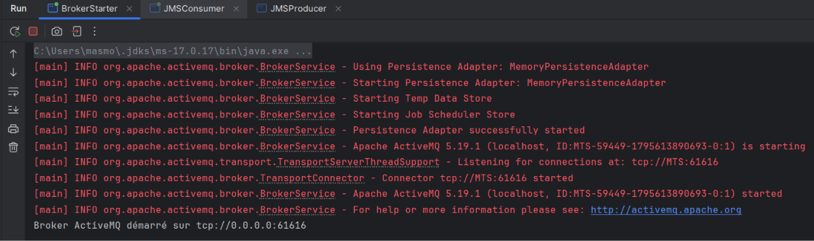
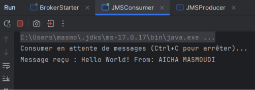
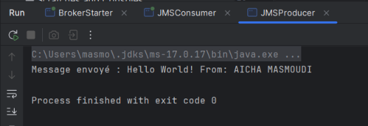

# TP7 – JMS avec ActiveMQ

**Étudiante :** AICHA MASMOUDI LSI3.1.1

## Objectif
Mettre en œuvre une communication asynchrone producteur/consommateur via JMS (Topic) avec un broker ActiveMQ embarqué.

## Structure
- `BrokerStarter` : démarre le broker (tcp://0.0.0.0:61616)
- `JMSConsumer` : s'abonne au topic `TP7.TOPIC` avec un `MessageListener`
- `JMSProducer` : publie "Hello World! From: ..." (non persistant, session transactionnelle)

## Exécution
1. Lancer `BrokerStarter`
2. Lancer `JMSConsumer`
3. Lancer `JMSProducer`

## Captures d'écran

### Démarrage du broker

### Réception du message par le consommateur

### Envoi du message par le producteur

## Synthèse
Ce TP a permis de mettre en œuvre une communication asynchrone avec JMS et ActiveMQ. Un broker ActiveMQ embarqué est démarré depuis une application Java (`BrokerStarter`) et écoute sur le port 61616.
Le producteur (`JMSProducer`) publie un message texte non persistant sur un Topic, via une session transactionnelle ; le `commit()` est nécessaire pour que le message soit réellement envoyé. Le consommateur (`JMSConsumer`) s'abonne au même Topic et reçoit les messages de façon asynchrone grâce à un `MessageListener`, sans bloquer son exécution.

Le modèle utilisé est publish/subscribe : le producteur et le consommateur ne se connaissent pas et ne communiquent qu'à travers le broker, ce qui les découple.
Comme le Topic n'est pas durable, le consommateur doit être démarré avant le producteur, sinon il ne reçoit pas le message.
Les résultats montrent que le message envoyé par le producteur a bien été reçu par le consommateur.